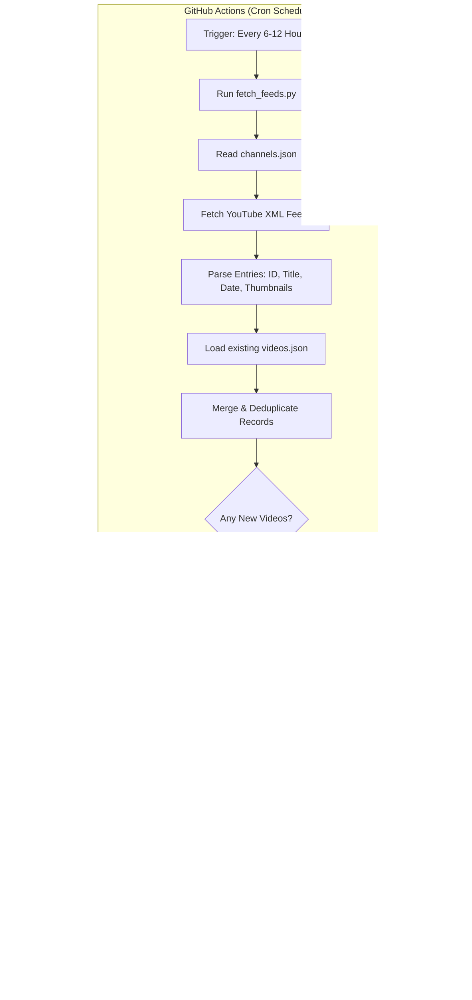

# Distraction-Free Islamic Video Portal: Specification & Implementation Plan

This document serves as the master blueprint and step-by-step implementation guide for building and deploying an automated, zero-cost, distraction-free Islamic Video Portal.

---

## 1. Project Overview & Architectural Vision

### 1.1 Goal
Create a fast, responsive, and distraction-free web portal that aggregates lectures, reminders, and educational videos from curated Islamic YouTube channels using native RSS feeds, automatically refreshed via GitHub Actions, with zero ongoing hosting or database costs.

### 1.2 Core Architectural Principles
- **Zero-Cost & Serverless:** Uses standard GitHub Pages for hosting and GitHub Actions for periodic background jobs.
- **Flat Data Architecture ("Git Scraping"):** Uses a version-controlled `videos.json` file as the system's database. No SQL or NoSQL database required.
- **Preserved Archive:** Overcomes YouTube's native 15-video RSS limit by merging and deduplicating new uploads against existing records on every cron run.
- **Distraction-Free Playback:** Leverages YouTube iframe parameters (`rel=0`, `iv_load_policy=3`, `modestbranding=1`) to strip algorithm clickbait, annotations, and third-party recommendations.
- **Universal Portability:** Works standalone on GitHub Pages, or can be deployed to any static host (Vercel, Netlify, Cloudflare Pages).

---

## 2. System Architecture & Data Flow



---

## 3. Component Specifications

### 3.1 Channel Registry (`channels.json`)
Maintains the list of active channels tracked by the pipeline.
```json
[
  {
    "id": "UC3vHW2h22WE-xqbfGSRZDXQ",
    "name": "Yaqeen Institute",
    "category": "Lectures & Research",
    "speaker": "Omar Suleiman & Team"
  },
  {
    "id": "UC_x5XG1OV2P6uZZ5FSM9Ttw",
    "name": "Mufti Menk",
    "category": "Reminders & Character",
    "speaker": "Mufti Ismail Menk"
  },
  {
    "id": "UC4d0Veqd2Fh67pM5Fp18qaw",
    "name": "Bayyinah Institute",
    "category": "Quran & Linguistics",
    "speaker": "Nouman Ali Khan"
  },
  {
    "id": "UCNdUFOtzSx3ukvRKnVVQ6HQ",
    "name": "FreeQuranEducation",
    "category": "Animations & Quick Reminders",
    "speaker": "Various"
  },
  {
    "id": "UCk31tX4o0GffhK4XvD_D50A",
    "name": "OnePath Network",
    "category": "Documentaries & Social",
    "speaker": "Various"
  }
]
```

### 3.2 Ingest Engine (`fetch_feeds.py`)
- **Runtime:** Python 3.10+ (Standard Library only: `urllib.request`, `xml.etree.ElementTree`, `json`, `datetime`). Zero third-party `pip` dependencies.
- **YouTube RSS Endpoint:** `https://www.youtube.com/feeds/videos.xml?channel_id={CHANNEL_ID}`
- **XML Mapping:**
  - Video ID: `<yt:videoId>`
  - Title: `<title>`
  - Published Date: `<published>` (ISO format)
  - Channel Title: `<author><name>`
  - Thumbnail URL: `https://i.ytimg.com/vi/{videoId}/hqdefault.jpg`
  - Description: `<media:group><media:description>`
- **Deduplication Logic:** Merges new items into `videos.json` keyed by unique `id`, sorted in descending order of `publishedAt`.

### 3.3 Data Schema (`videos.json`)
```json
[
  {
    "id": "d9OV_youpfE",
    "title": "Example Lecture Title",
    "channelId": "UC3vHW2h22WE-xqbfGSRZDXQ",
    "channel": "Yaqeen Institute",
    "publishedAt": "2026-11-02T14:30:00+00:00",
    "thumbnail": "https://i.ytimg.com/vi/d9OV_youpfE/hqdefault.jpg",
    "description": "Short excerpt of lecture summary..."
  }
]
```

### 3.4 Automated Workflow (`.github/workflows/update.yml`)
- Runs on a cron schedule (`0 */6 * * *`) and supports `workflow_dispatch` for manual triggers.
- Executes `python fetch_feeds.py`.
- Uses `stefanzweifel/git-auto-commit-action@v5` to commit changes only when new videos arrive.

### 3.5 Frontend Client (`index.html`, `style.css`, `app.js`)
- **UI Design:** Clean Islamic-themed dark mode (slate/indigo/teal palette).
- **Video Grid:** Responsive grid using CSS Grid / Flexbox with thumbnail lazy-loading.
- **Search Engine:** In-memory, instant client-side filtering on `title`, `channel`, and `description`.
- **Channel Filters:** Pill-style category/channel toggle filters.
- **Distraction-Free Player:**
  - Embed URL format: `https://www.youtube.com/embed/{VIDEO_ID}?rel=0&modestbranding=1&iv_load_policy=3&playsinline=1`
  - Modal or theater layout preventing navigation to YouTube.

### Phase 5: Deployment & Verification
- [ ] Configure repository Settings -> Pages -> Deploy from branch (`main`, root).
- [ ] Verify live deployment on `https://<username>.github.io/<repo>`.
- [ ] Verify mobile responsiveness and fast search across all devices.

---

## 5. Key Pitfalls & Resolution Rules

| Issue | Root Cause | Solution |
| :--- | :--- | :--- |
| **Error 153** | Missing Referrer/Origin when opened via `file:///` URI | Test locally with `python -m http.server 8000` or deploy on `https://`. Use `youtube.com` instead of `youtube-nocookie.com` if strict origins are blocked. |
| **Channel ID Discovery** | Channels show handles (`@channel`) rather than `UC...` IDs | View page source of the YouTube channel and search for `"externalId":"UC..."`. |
| **15-Video Truncation** | YouTube RSS feed only serves the last 15 items | Ensure `fetch_feeds.py` merges and deduplicates against existing `videos.json` rather than overwriting it blindly. |
| **GitHub Actions Merge Conflict** | Concurrent edits or pushes during action run | Configure Git auto-commit action with rebase or pull before commit. |

